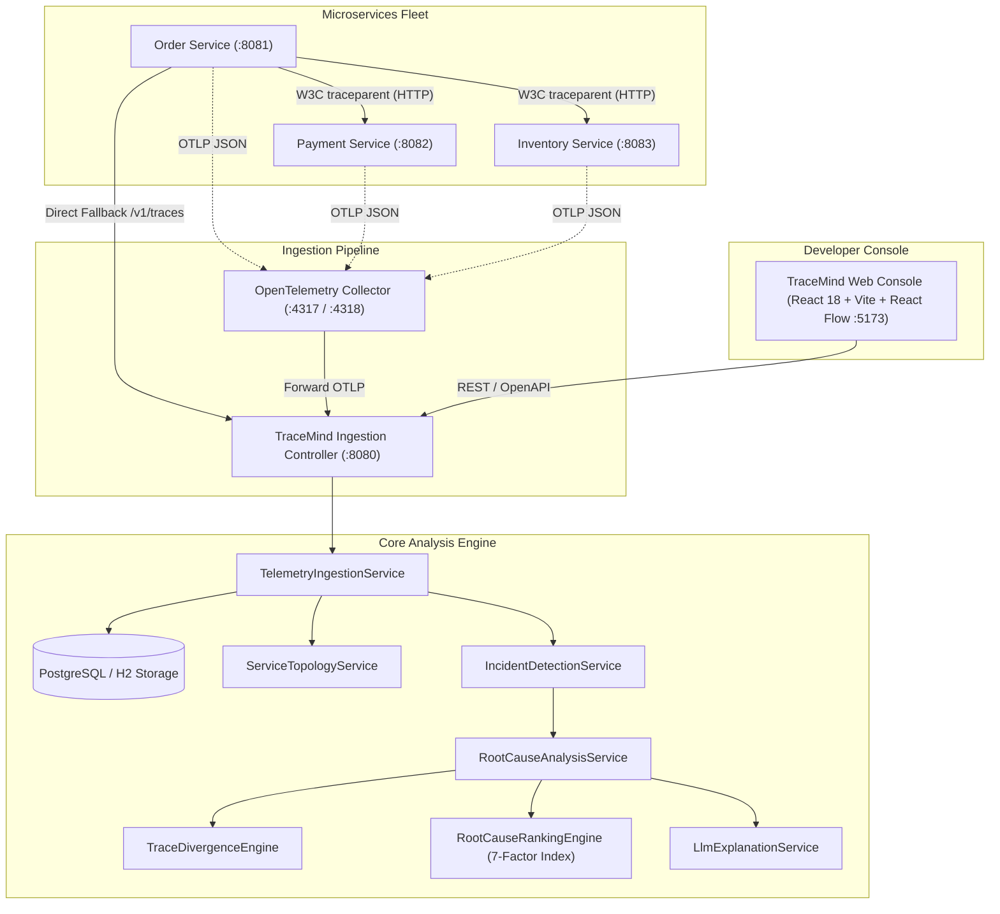

# TraceMind — System Architecture & Technical Specifications

> **Tagline:** Every failure has a story. Find its origin.

---

## 1. High-Level Architectural Overview

TraceMind is a distributed systems observability and automated root-cause analysis platform. Unlike passive monitoring tools or basic log dashboards, TraceMind reconstructs end-to-end execution trees, models service dependency graphs, performs sequence alignment divergence analysis between healthy and degraded traces, and deterministically ranks causal anomalies using a 7-factor causal index.



---

## 2. Distributed Telemetry & W3C TraceContext Propagation

TraceMind enforces the **W3C TraceContext recommendation** across all microservice boundaries. 
When an HTTP request enters the gateway or `order-service`:
1. **TraceContext Initialization**:
   - The `TracingFilter` checks for an existing `traceparent` header matching `00-{traceId}-{spanId}-{flags}`.
   - If absent, a cryptographically secure 16-byte (32-character hex) `traceId` and 8-byte (16-character hex) `spanId` are generated.
   - Context is bound to `TraceContextHolder` (ThreadLocal).
2. **Context Propagation Across HTTP Boundaries**:
   - `TracingRestTemplateInterceptor` intercepts outgoing HTTP client requests from `order-service` to `payment-service` and `inventory-service`.
   - It generates a child client `spanId` and injects:
     ```http
     traceparent: 00-4bf92f3577b34da6a3ce929d0e0e4736-00f067aa0ba902b7-01
     X-Trace-Id: 4bf92f3577b34da6a3ce929d0e0e4736
     ```
3. **Downstream Span Continuation**:
   - `payment-service` and `inventory-service` extract the parent `spanId` from `traceparent`, generate their own server `spanId`, and maintain the shared `traceId`.
4. **Asynchronous Non-Blocking Reporting**:
   - Upon request completion or exception capture, spans are formatted into standard OTLP JSON payloads and submitted asynchronously via a fixed thread pool to TraceMind backend `/v1/traces`.

---

## 3. Algorithmic Trace Divergence Engine

The `TraceDivergenceEngine` addresses the core problem of debugging complex microservices: *Why did request A succeed in 80ms while request B failed in 3550ms?*

### Algorithm:
1. **Sequence Normalization**: Spans from a healthy baseline trace and target degraded trace are normalized by `serviceName::operationName`.
2. **Temporal Alignment**: Target spans are ordered chronologically by their start timestamps.
3. **Differential Detection**:
   - **Status Mismatch**: Detects transitions from `OK` to `ERROR` or HTTP $5xx$ status codes.
   - **Latency Dilation**: Identifies operations where duration increases by $\ge 2\times$ baseline and exceeds $150\text{ ms}$.
   - **Topology Drift & Call Missing**: Detects downstream operations that were bypassed (e.g. inventory call never made because payment timed out).
4. **Earliest Point of Divergence**:
   The engine isolates the earliest temporal difference in the downstream execution graph, proving whether a downstream failure occurred *before* the caller timed out.

---

## 4. Multi-Factor Deterministic Root-Cause Ranking Engine

TraceMind avoids the **Root Caller Fallacy** (where an orchestrator like Order Service is mistakenly blamed because its total duration wraps the entire transaction).

The engine computes an explainable composite causal score $S(c) \in [0.0, 1.0]$ for each candidate:

$$S(c) = w_{err} S_{err} + w_{lat} S_{lat} + w_{prec} S_{prec} + w_{blast} S_{blast} + w_{rec} S_{rec} - w_{caller} P_{caller} - w_{counter} S_{counter} - w_{comp} P_{comp}$$

### Factor Definitions & Weights:
- **$w_{err} = 0.35$ (Error Status Index)**: Proportion of executions with explicit error status codes or exceptions.
- **$w_{lat} = 0.30$ (Relative Latency Dilation)**: Relative ratio of measured latency against healthy baseline $\frac{\text{duration}}{\text{baseline}}$.
- **$w_{prec} = 0.15$ (Temporal Precedence)**: $1.0$ for downstream leaf operations initiating the failure cascade; $0.3$ for caller wrappers.
- **$w_{blast} = 0.10$ (Blast Radius)**: Ratio of downstream dependencies affected by this candidate's delay or exception.
- **$w_{rec} = 0.10$ (Cross-Trace Recurrence)**: Frequency of recurrence across independent failed traces in the incident window.
- **$w_{caller} = 0.35$ (Caller Wrapper Penalty)**: Penalizes upstream orchestrators whose failure was caused by a downstream callee's error.
- **$w_{counter} = 0.15$ (Counterevidence)**: Penalizes candidates that behave normally and within SLA in healthy baseline traces.
- **$w_{comp} = 0.15$ (Completeness Penalty)**: Penalizes candidates with unobserved or missing parent spans.

---

## 5. Controlled Replay & Fault Injection Laboratory

To guarantee safety and prevent unintended disruption to real external systems:
1. **Target Sandbox Whitelisting**: Replay traffic is strictly restricted to local sandbox microservices (`order-service` on port 8081). External endpoints are blocked.
2. **Two-Phase Validation**:
   - Phase 1: `/api/v1/replay/preview` runs validation on request volume (bounded $\le 20$), payload safety, and returns simulated request previews.
   - Phase 2: `/api/v1/replay/execute` requires explicit client confirmation (`confirmed: true`).
3. **Automated Fault Lifecycle**: The laboratory configures the fault, executes synthetic traffic, captures telemetry, and automatically restores services to baseline.
4. **Audit Logging**: Every replay execution is permanently recorded in `replay_runs` with success/failure statistics.
